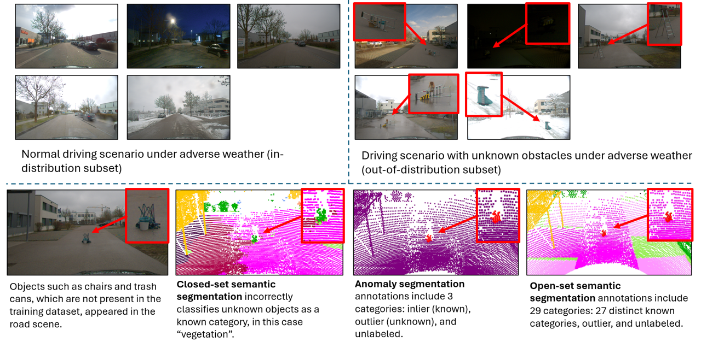
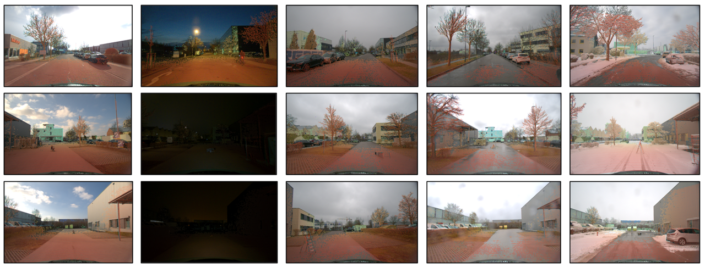
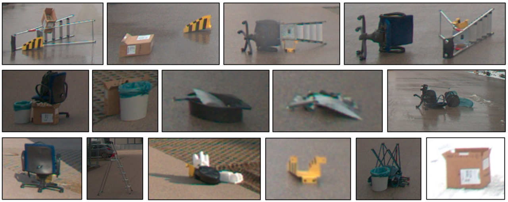

# DriveOSS: Dataset and Benchmark for 3D Anomaly Segmentation and Open-set Semantic Segmentation in Autonomous Driving

This repository is the official implementation of DriveOSS: Dataset and Benchmark for 3D Open-set Segmentation under Adverse Weather in Autonomous Driving. 


<p align="center">

</p>

</div>


<!-- <p align="center">

</p> -->
<p align="center">

</p>
<p align="center">
 <em>
Representative anomalies in the DriveOSS dataset.
</em>
</p>
<!-- <em>
Point-cloud-to-image projection under different weather conditions. 
From left to right, the columns show clear, night, cloudy, rainy, 
and snowy conditions. From top to bottom, the rows correspond to 
DriveOSS-ID, DriveOSS-OOD validation, and DriveOSS-OOD test scenes. 
The projected points reflect weather-dependent LiDAR return 
distributions, with notably fewer road-surface reflections observed 
under rainy conditions.
</em>
</p> -->

 
**DriveOSS** is a multimodal dataset for 3D open-set semantic segmentation autonomous driving. It contains 12,661 synchronized and annotated frames captured using six surround-view RGB cameras, a 128-beam LiDAR, and a GPS/IMU unit. The dataset comprises 52 real-world driving scenes collected under clear, nighttime, cloudy, rainy, and snowy conditions and is organized into ID (in-distribution) and OOD (out-of-distribution) subsets.

**NOTE about DriveOSS-OOD Test Set**: Annotations for the OOD test split are not provided in order to ensure fair and unbiased evaluation. A public evaluation server for evaluation on the DriveOSS-OOD test set is planned upon acceptance in the future, but for now, please send us the predictions results and anomaly scores on the test set. Please also include the evaluation results for each anomaly scoring method on the val set as a zip file. These files contain threshold values for each anomaly scores, which are needed for open set evaluation on the test set. We will run the evaluation using the [evaluate_multi_sequence_openset.py](./evaluate_multi_sequence_openset.py) script present in this github, follwing the same evaluation protocol as for the OOD val set.

#### Dataset Organization

  The dataset is organized into two subsets:
</p>
<ul>
  <li>
    <strong>In-distribution (ID) subset:</strong> Contains normal driving 
    scenarios with 27 semantic classes. Used for closed-set model training 
    and validation.
  </li>
  <li>
    <strong>Out-of-distribution (OOD) subset:</strong> Contains the same 
    27 semantic classes plus an additional <em>outlier</em> class 
    representing unknown road obstacles deliberately placed in controlled 
    environments. Further divided into validation and test splits for 
    open-set evaluation.
  </li>
</ul>
<table>
  <thead>
    <tr>
      <th align="left">Weather Condition</th>
      <th align="center">ID Train Scenes</th>
      <th align="center">ID Validation Scenes</th>
      <th align="center">OOD Validation Scenes</th>
      <th align="center">OOD Test Scenes</th>
    </tr>
  </thead>
  <tbody>
    <tr>
      <td><strong>Clear-Day</strong></td>
       <td align="center">311, 322, 324, 327</td>
      <td align="center">316, 323, 325, 326, 329, 330</td>
      <td align="center">411, 412, 461, 462, 463, 463, 465, 566, 567</td>
      <td align="center">413, 414, 471, 472, 473, 474, 475, 476</td>
    </tr>
    <tr>
      <td><strong>Night</strong></td>
            <td align="center">312</td>
      <td align="center">317</td>
      <td align="center">421, 422</td>
      <td align="center">423, 424</td>
    </tr>
    <tr>
      <td><strong>Rain</strong></td>
            <td align="center">314</td>
      <td align="center">319</td>
      <td align="center">441, 442</td>
      <td align="center">443, 444</td>
    </tr>
    <tr>
      <td><strong>Cloudy</strong></td>
            <td align="center">313, 321</td>
      <td align="center">318</td>
      <td align="center">431, 432</td>
      <td align="center">433, 434</td>
    </tr>
    <tr>
      <td><strong>Snow</strong></td>
            <td align="center">315</td>
      <td align="center">320</td>
      <td align="center">451, 452</td>
      <td align="center">453, 454</td>
    </tr>
  </tbody>
</table>

## Dataset and Pre-trained Models Download

The full DriveOSS dataset, along with the pretrained benchmark models are uploaded to the [Dataverse](https://doi.org/10.7910/DVN/SIEZCG). 

## Requirements and Environment Setup

As this paper proposes a new dataset and benchmark rather than a new method, we request the users to follow instructions mentioned on the original codebase of the respective models. We recommend creating separate virtual environments for each method as each method might require different torch and cuda versions. Here are the links to official implementations of the baseline models:
- [P3Former](https://github.com/InternRobotics/P3Former)
- [LCPS](https://github.com/zhangzw12319/lcps)
- LCPS-Fusion: same as LCPS
- [Mask4ormer3D](https://github.com/kumuji/stu_dataset/tree/main/Mask4Former3D)
- Mask4Former3D-Fusion: same as Mask4Former3D

## Data Visualization

```bash
cd /path/to/DriveOSS/scripts

# Visualize anomaly Ground Truth
python3 vis_GT_outlier.py --velodyne <path/to/lidar> --label <path/to/label>

# Visualize Open-set Ground Truth
python3 vis_GT_openset.py --velodyne <path/to/lidar> --label <path/to/label>
```

## Training Benchmark Models

To train the benchmark models presented in the paper, you can find the detailed instructions in this [file](./docs/train_baselines.md).

## Inference and Anomaly Scoring

To run inference and obtain anomaly scores on the benchmark models presented in the paper, you can find the detailed instructions in this [file](./docs/inference_on_baselines.md).

## Open-Set Evaluation

After the inference you should have the following folder structure. 

```tree
outputs
|── msp/
|   ├── msp_000000.txt
|   |   .
|   ├── msp_000XXX.txt
|── energy/
|   ├── energy_000000.txt
|   |   .
|   ├── energy_000XXX.txt
|── entropy/
|   ├── entropy_000000.txt
|   |   .
|   ├── entropy_000XXX.txt
|── maxlogit/
|   ├── maxlogit_000000.txt
|   |   .
|   ├── maxlogit_000XXX.txt
|── rba/
|   ├── rba_000000.txt
|   |   .
|   ├── rba_000XXX.txt
|── predictions/
|   ├── 000000.txt
|   |   .
|   ├── 000XXX.txt
```
Now, copy all .txt files from the ```predictions``` folder to each of the anomaly scoring method folders. Each anomaly folder should contain anomaly scores for the corresponding method as well as the semantic predictions.  
```tree
outputs
|── msp/
|   ├── msp_000000.txt
|   ├── 000000.txt
```
**Important Note** : The below script (```evaluate_multi_sequence_openset.py```) expects semantic segmentation output in the range 0-19. The models P3Former and Mask4Former (both variants) follows this output format. However, the LCPS model provides output in the range 1-20. In this case, an additional flag ```--pred-label-offset 1``` must be provided to the script below. 

Run the evaluation on the DriveOSS-OOD val set to obtain per-sequence as well as overall anomaly segmentation results (AUROC, FPR@95, AP), threshold for segmentation, closed set segmentation evaluation metrics (per class iou and global miou), and open-set results. For this purpose, use the evaluation script for each anomaly method as follows:
```bash
cd /path/to/DriveOSS
# this must be run for each anomaly method, keep in mind to change the output path and anomaly prefix flags.
python evaluate_multi_sequence_openset.py \
  --data-root "data/semantickitti/dataset/sequences" \
  --pred-root "outputs/" \
  --yaml "./semantic-kitti.yaml" \
  --sequences 411 421 431 441 451 412 422 432 442 452 \
  --output results_10seq_val_energy.json \
  --closed-prefix "" \ 
  --anomaly-prefix energy_ 
```
To obtain the weather specific evaluation results, please follow the same steps as above, but replace the sequences with specific weather scenes.

Alternatively, run the bash file to automatically generate evaluation json for each anomaly scoring method:
**Note**: please keep in mind to change important variables  in the bash files before running. Specifically, ```BASE_DIR``` (root path to prediction results), ```--data-root``` (path to dataset), and ```--pred-label-offset 1``` (only if the semantic prediction .txt files are in range 1-20).

```bash
cd /path/to/DriveOSS
# to evaluate all anomaly scoring methods on the entire DriveOSS-OOD val set.
bash eval_all_anomaly_10seq.sh

# to evaluate all anomaly scoring methods on per weather sequences val set.
bash eval_all_anomaly_per_weather.sh
```

## Citation
TODO - upon acceptancce.


